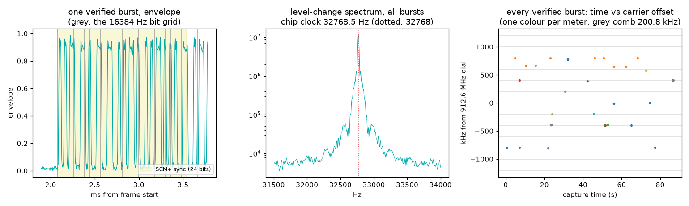

# ERT utility meters — the grid that runs on a watch crystal

Every gas, water and electric meter with a radio module on it is a
transmitter you can hear from the sofa. Itron's **ERT** (Encoder
Receiver Transmitter) modules "bubble up" a few-millisecond burst every
few seconds to every minute, hopping around the 910–920 MHz ISM band,
so that a utility truck rolling past collects a whole street without
stopping. The grid is built for a module that has to live for years on
one battery: on-off keying (the cheapest transmitter there
is), Manchester coding (the cheapest clock recovery there is), and a chip
rate that is not a round number but a *familiar* one — **32768 Hz**, the
frequency of the crystal in every wristwatch.

## The grid

| element | value | why |
|---|---|---|
| Chip clock | **32768 chips/s** = 2^15 | the module's timebase is a 32.768 kHz watch crystal; the RF chips *are* its ticks |
| Bit clock | **16384 bit/s**, Manchester | each bit = two chips of opposite level, so **every bit centre is a transition**: the receiver's clock is guaranteed, data-independent |
| Modulation | OOK (carrier keyed by the chips) | amplitude-only: the envelope *is* the bitstream |
| SCM frame | **96 bits** behind a 21-bit preamble `0x1F2A60`; CRC-16 poly `0x6F63` | the 1980s format: ID, type, a 24-bit reading |
| SCM+ frame | **128 bits** behind sync `0x16A3` + protocol `0x1E`; CRC-16/CCITT `0x1021`, init `0x0971` | 32-bit ID, 32-bit reading, tamper flags |
| IDM frame | **720 bits** behind `0x16A3` + `0x1C`; CRC `0x1021`, init `0xD895` | 47 interval readings in one burst (electric meters) |
| Channels | hopping across 910–920 MHz, FCC 15.247 | many uncoordinated meters, no collisions worth caring about |

What the Manchester guarantee buys: a 5.9 ms SCM burst carries 96
bit-centre transitions, *always*, whatever the data. There is no
preamble long enough to need a PLL and nothing to "lock" in the
carrier-tracking sense — the burst is over before a loop would settle.
Timing is read from the transitions of the burst itself (we fold them
modulo one chip and take the circular mean), the sync word is found,
and the CRC referees. That is the whole receiver.

## What we measured (912.6 MHz, 2.4 MS/s, 90 s, discone)

```
synthetic self-test: 6/6 CRC-verified, bit-exact recoveries (3 SCM + 3 SCM+)
bursts >= 2.5 ms: 111 in 90 s
two-level (OOK) envelopes: 53; the other 58 are FSK or too weak to tune
CRC-verified frames: 31  {'SCM+': 5, 'SCM': 21, 'IDM': 5}
Manchester polarity that passed CRC: {'10': 31}  (bit 1 = carrier-on then carrier-off)
transitions at bit centres: 6256/6256   at bit boundaries: 3756/6225 (60% - data-dependent)
chip clock: 32768.5 Hz (+32.3 dB) - published 32768 (+16 ppm, all meters pooled)
meters heard (IDs masked to last 2 digits): 14
hop comb over 31 verified bursts: best spacing 200.75 kHz (R = 0.821), residual 21.1 kHz rms
  channels occupied in this window: [-4, -2, -1, 0, 1, 2, 3, 4] x 201 kHz
referee (rtl_433 on the same file): 5 frames {'SCMplus': 3, 'Neptune-R900': 2}
  ERT IDs: ours 11, rtl_433 2, common 2, ours-only 9, rtl_433-only 0
```

| constant | published | measured |
|---|---|---|
| chip clock | 32768 Hz | **32768.5 Hz** (+16 ppm: the meters' crystals and our SDR's clock, pooled), +32 dB line, from the level changes of every OOK burst — decoded or not |
| bit-centre transitions | 100 % (Manchester) | **6256 / 6256** over 31 verified frames |
| bit-boundary transitions | data-dependent | 60 % — the half that isn't a clock |
| SCM / SCM+ / IDM lengths | 96 / 128 / 720 bits | burst durations pile up at 5.9, 7.8 and 44 ms (49 / 28 / 8 bursts) |
| Manchester polarity | (not in the open decoders' docs) | **"10"**: a 1 is carrier-on then carrier-off, 31/31 — the other polarity never passes a CRC |
| CRC-16 0x6F63 / 0x1021+0x0971 / 0x1021+0xD895 | rtl_433 constants | 21 / 5 / 5 frames pass; the opposite polarity and the other chip pairing, tried on every burst, pass 0 |
| channel spacing | not published anywhere we could find | **≈ 200 kHz**: carrier offsets fold at 200.75 kHz with R = 0.82; eight of the nine 200 kHz slots in our 2.4 MHz window are in use |



Left: one SCM+ burst's envelope against the 16384 Hz bit grid (grey)
with its 24-bit sync shaded — every grey line has an edge under it.
Middle: the level-change spectrum of all 53 OOK bursts pooled, with no
decoding involved, standing on 32768 Hz to 16 ppm. Right: every
CRC-verified burst, time against carrier offset, one colour per meter:
each meter wanders the whole window, and the wandering is quantized.

## Honesty notes

- **The referee lost, and that is worth understanding.** rtl_433 on the
  same file verified 5 frames; this script verified 31, with every one
  of rtl_433's ERT IDs among ours and none of ours contradicted. The
  difference is not cleverness: rtl_433 demodulates the *whole* 2.4 MHz
  as one OOK channel, so a burst 800 kHz off the dial competes with
  2.4 MHz of noise. We find each burst's carrier first (OOK keeps half
  its power in a carrier line, so an FFT peak is enough), then filter to
  ±60 kHz: 16 dB of processing gain for free. Point rtl_433 at a
  narrower window and it will catch up.
- **Half the bursts in this band are not ERT.** 58 of 111 bursts had a
  Rayleigh-shaped envelope (hi/lo quartile ratio under 4): the Neptune
  R900 water-meter population, which is FSK, plus a 156 ms burst type we
  did not chase. Before this gate existed those bursts voted on the
  chip-clock spectrum and elected 100 kHz — the rate at which a noise
  envelope crosses a threshold inside a 60 kHz filter. A measurement
  that pools "all bursts" must first ask which bursts are the signal.
- **The channel comb is real but blurred.** 200 kHz wins the fold
  search clearly (R = 0.82 against 0.69 at 100 kHz and 0.18 at 250 kHz)
  and the occupied slots are integers of it, but the residual is 21 kHz
  rms. Two reasons we can see: crystal error (ours plus each meter's —
  the busiest meter lands −13…+7 kHz from its slots across five
  different slots), and one electric meter that transmits at +652 and
  +668 kHz, which no spacing in the 20–600 kHz search explains. We only
  see 2.4 MHz of a 10 MHz hop set; a wider capture would settle whether
  that meter is on a second grid.
- **Gain and integrity.** Two more 90 s captures at 12 dB more IF gain
  both came back with the capture tool's integrity line reading
  SAMPLES LOST (−4300 and −12200 ppm) and fewer verified frames (19),
  even with the CPU idle for the second. The numbers above are from the
  capture whose integrity line reads OK (−21 ppm). Read the integrity
  file before the results.

## Reproduce it

```
python measure.py --iq ert_912p6.cs16 --fs 2400000 [--referee rtl433.jsonl]
```
Tune 912.6 MHz (the centre most open decoders use), 2.4 MS/s, **fixed
gain, AGC off**, any antenna with a view of a street — the modules are
low-power, but there are dozens of them within a few hundred metres of
almost any house in North America. 90 s is plenty. For the
referee line, run `rtl_433 -r cap.cs16 -s 2400k -R 149 -R 154 -R 160
-R 161 -F json:rtl433.jsonl` on the same file.

**Privacy:** the script masks every meter ID to its last two digits and
never prints a reading. The IDs are your neighbours' meters and the
readings are their gas bills; leave them in the capture, which stays on
your disk.
