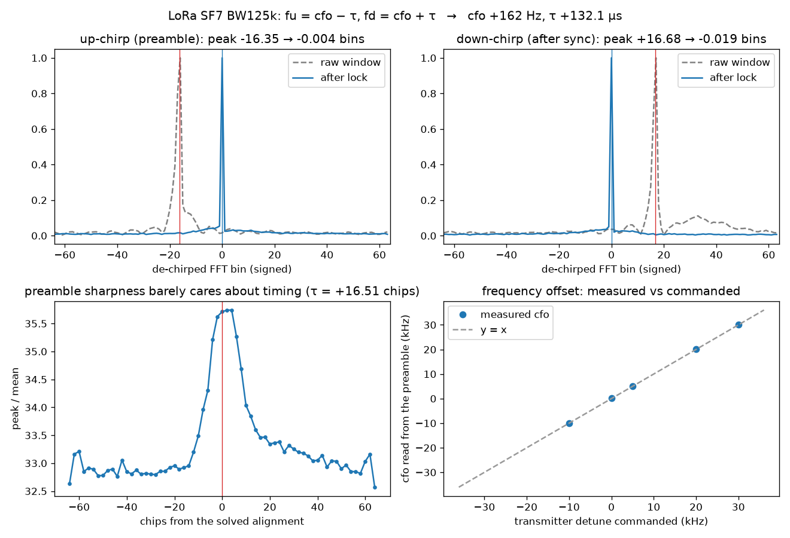

# LoRa — symbol lock: the preamble that measures its own offsets

## The grid

| parameter | value (SF7, BW 125 kHz) | why |
|---|---|---|
| Symbol | a chirp sweeping −BW/2 → +BW/2 in N = 2^SF chips | de-chirp (multiply by the conjugate sweep) and an FFT turns every symbol into one spike |
| Chip | 1/BW = **8.0 µs**; symbol = 128 chips = 1.024 ms | the FFT has N bins; one bin = BW/N = **976.6 Hz** |
| Preamble | 8+ identical **up**-chirps, 2 sync-word symbols, **2.25 down-chirps** | the down-chirps are not decoration — they are the second equation |
| Sync word | two symbols, nibble × 8 as a *signed* 4-bit value (0x34 → 24, 32) | public LoRa 0x34, Meshtastic 0x2B, private 0x12 |
| Frequency tolerance | ±25 % of BW (±31 kHz here) | what the chips specify, what the lock below actually holds |

A window that starts **τ chips off** the chirp boundary, from a transmitter
**cfo bins off** frequency, puts the de-chirped spike at

```
up-chirp:    fu = cfo − τ
down-chirp:  fd = cfo + τ
```

One spike can't tell timing from frequency: both just move it. Two spikes of
opposite slope can. Add them and τ cancels; subtract them and cfo cancels:

```
cfo = (fu + fd) / 2         τ = (fd − fu) / 2
```

That is the whole lock. No loop, no guessing, no sweep over hypotheses: read
two bins, do two divisions, re-cut the sample stream with the answer.

## What we measured (Heltec V3 → RSPdx at 1 MS/s, 915 MHz, SF7 BW125k)

```
up-chirp bin  fu = -16.35      down-chirp bin fd = +16.68
cfo = (fu+fd)/2 =  +0.17 bins = +162 Hz
tau = (fd-fu)/2 = +16.51 chips = +132.1 us
after re-cut:   up -0.004  down -0.019 bins
sync word       7.65, 15.66  ->  23.98, 31.97   (want 24, 32)
```



Top row: the raw window's spike sits 16 bins off in opposite directions for the
up- and down-chirp (the τ term flips sign); after the re-cut both sit on bin 0
to a few thousandths of a bin. The sync word, which read as nonsense before
(7.65, 15.66), reads 24, 32 after — the same two bytes the transmitter was
told to send.

**Frequency lock range, measured not quoted.** The transmitter was deliberately
detuned and the receiver told nothing about it:

| commanded | read from the preamble | diff |
|---|---|---|
| −10 kHz | −9.93 kHz | +0.07 |
| 0 | +0.16 kHz | +0.16 |
| +5 kHz | +5.10 kHz | +0.10 |
| +20 kHz | +20.16 kHz | +0.16 |
| +30 kHz | +30.04 kHz | +0.04 |

Slope 0.9994. The constant ~+0.1 kHz is the two radios' combined crystal error
at 915 MHz, not a bias in the method — it is the same on every frame. At +30 kHz
(24 % of BW, the edge of what LoRa promises) the residuals after re-cut grow to
0.36 / 0.53 bins: part of the chirp is now sweeping outside the channel filter.
Still locked, still decodable, honestly degraded.

## How we found it

- **Sharpness can't find τ** (bottom-left panel). We expected the up-chirp
  spike to get sharp only at the right timing. It doesn't: a mis-timed window
  straddles two *identical* preamble chirps, which still de-chirp to one clean
  spike — just at a shifted bin. Peak/mean varies 33 → 36 across a full
  symbol of offset. The preamble hides timing error by design; that is why
  the standard spends 2.25 symbols on down-chirps.
- **The sum is ambiguous by N/2.** Bins wrap, so (fu + fd)/2 has two answers
  half a bandwidth apart, and the sign of τ can't be read from magnitudes.
  Try both, keep whichever puts the preamble, the sync word *and* the
  down-chirp where they belong — four checks for one unknown bit.
- **The sync word is signed.** 0x2B at SF11 decodes as B → −40, not 88. At
  SF7 the two coincide mod 128, which is how this went unnoticed until a
  Meshtastic capture.
- **The capture's own integrity file says the SDR dropped 609 ppm of samples**
  during the +5 kHz run. Lock survives because it is re-measured per frame
  (50 ms); a drop *inside* a frame is a lost frame, a drop between frames is
  invisible. Check integrity before blaming the signal.
- Independent re-implementation check: this script shares no code with the
  [numpy-lora](https://github.com/Felbs/numpy-lora) decoder that produced the
  captures' decode logs, and agrees with it frame-by-frame (cfo 5.22 vs 5.25
  bins, τ 40.99 vs 40.85 chips on the +5 kHz capture).

## Reproduce it

```
python measure.py --iq cap.cs16 --fs 1e6 --offset-khz -200 --sf 7 --bw 125e3
python measure.py --iq F9150.cs16 ... --sweep CFO+5k.cs16:5 CFO-10k.cs16:-10 CFO+20k.cs16:20
```

Any LoRa transmitter you control (a Heltec, a Meshtastic node with
`--sync 0x2B`) and any SDR that writes interleaved int16 I/Q. Tune 200 kHz
off the channel to keep the DC spike out of the signal, and record at least
one full frame.
