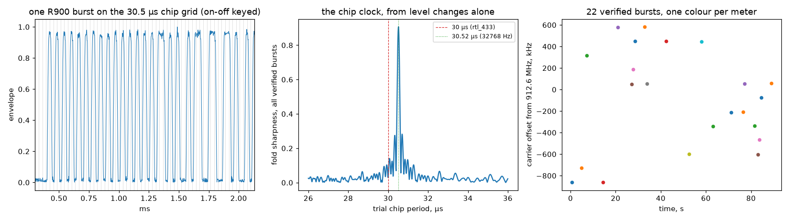

# Neptune R900 water meters — the other watch crystal in the 912 MHz band

The [ERT entry](../ert-amr-915/) found that **58 of 111 bursts** at
912.6 MHz were not Itron at all and set them aside as "FSK or too weak".
Most of them turn out to be Neptune **R900** radio modules on water
meters: a second meter-reading system sharing the same ISM band and the
same streets. This entry measures that second population on its own
terms, and finds that it is not FSK, and that it runs on the same
32.768 kHz crystal as the gas meters — one tick per chip instead of two.

## The grid

| element | value | why |
|---|---|---|
| Band | 910–920 MHz ISM, FCC 15.247 | the same unlicensed band as Itron ERT |
| Modulation | **on-off keying** | the envelope of every decoded burst is two-level (upper/lower quartile ratio 15 median, against 2.7 for the bursts that are not R900) |
| Chip clock | **32768 chips/s** (30.52 µs) | a 32.768 kHz watch crystal, one chip per tick; rtl_433's "30 µs" is a rounding of this |
| Line code | **2-of-4 constant-weight**: each group of four chips is one of `0011 0101 0110 1100 1010 1001`, i.e. a base-6 digit; a pair of digits (base 36) carries 5 bits | DC-balanced on-off keying (exactly half the chips are on), and a built-in integrity check |
| Frame | preamble of alternating chips, sync `AB 52 CC D2` + `1100101`, then **168 chips = 42 digits = 105 payload bits** (32-bit ID, flags, 24-bit consumption, extras) | 7.0 ms on air |
| Integrity | **no CRC.** A frame is valid when all 42 groups are weight-2 | a random 168-chip string passes once in 8 × 10¹⁷ — stronger than a CRC-16, and it costs nothing |
| Cadence | one burst per meter about every **28 s** | gaps between a meter's verified bursts cluster at 28 and 56 s |
| Channels | hopping on a **131 kHz** comb | carrier offsets of 22 verified bursts fold at 131.0 kHz with R = 0.99; 12 consecutive slots occupied in our 2.4 MHz window |

What the code buys: a receiver needs no clock recovery beyond the chip
rate (every digit has a transition inside it), no CRC table and no
length field — and an error anywhere in the 168 chips shows up as an
illegal digit with near certainty. It is the Manchester idea of the ERT
entry generalised: Manchester is the 1-of-2 code, this is 2-of-4,
denser by 25 %.

## What we measured (912.6 MHz, 2.4 MS/s, 90 s, discone)

```
integrity: a random 4-chip group is code-valid with p = 6/16; 42 groups -> p = 1.3e-18
synthetic self-test: 4/4 frames recovered bit-exact (carrier offsets up to ±800 kHz, 20 dB SNR)
bursts >= 2.5 ms: 111 in 90 s
two-level (OOK) envelopes: 55   other (FSK or too weak): 56
per-burst chip period from the fold: median 30.52 us, 10-90 % 30.51-30.52 us
code-valid R900 frames: 22  from 13 meters (IDs masked)
chip period over verified frames: 30.520 us -> 32765 chips/s
burst length of verified frames: 7.1 ms
envelope hi/lo of verified frames: median 15 (OOK)  vs non-OOK bursts: 2.7
hop comb over 22 verified bursts: best spacing 131.0 kHz (R = 0.99); occupied slots -7 ... +4 x 131 kHz
referee (rtl_433 on the same file): 5 frames {'Neptune-R900': 5}
  R900 IDs (last 2 digits): ours 12, rtl_433 3, common 3, ours-only 9, rtl_433-only 0
```

| constant | published | measured |
|---|---|---|
| chip period | 30 µs (rtl_433) | **30.520 µs** = 32,765 chips/s, within 100 ppm of 32,768 Hz, from the fold of every level change of every OOK burst, no decoding involved; spread across bursts below 0.01 µs |
| modulation | "PPM" (rtl_433), "FSK" (our own earlier envelope test) | on-off keying: hi/lo envelope ratio 15 on verified frames |
| code | 2-of-4 digits, 168 chips (rtl_433) | 22 frames with 42/42 legal digits; 33 OOK bursts with the sync but an illegal digit somewhere (the band is full of collisions) |
| cadence | "every xx seconds" (rtl_433) | 28 s (and 56 s where one burst hopped out of our window) |
| channel spacing | not published | **131 kHz**, R = 0.99 over 22 bursts |



Left: the envelope of one verified burst against the 30.52 µs chip grid
(grey): on-off keyed, two levels, exactly half the chips on. Middle:
the sharpness of the fold of all verified bursts' level changes against
the trial chip period — it stands on 30.52 µs (the 32.768 kHz tick), not
on 30 µs. Right: every verified burst, time against carrier offset, one
colour per meter: the offsets sit on a 131 kHz comb.

## Honesty notes

- **Our own earlier measurement called these bursts FSK, and it was
  wrong.** The ERT script decided "two-level or not" after a ±60 kHz
  filter centred on the strongest FFT bin. An R900 burst's spectrum is
  wide (33 kchip/s on-off keying spreads it over ±100 kHz) and its
  strongest bin is not always the carrier, so the filter clipped the
  signal into a Rayleigh-looking envelope. Here the channel is ±150 kHz
  and the carrier is still estimated from the FFT peak; the envelope
  ratio then separates the populations cleanly (15 against 2.7). A
  classifier is only as good as the bandwidth in front of it.
- **The sync alignment matters for the ID, and rtl_433's is the
  reference.** A first version of this script took the data to start
  right after `0xD2`; frames decoded as valid code just the same (the
  2-of-4 grouping has a period of four chips, and the seven sync chips
  that follow `0xD2` happen to be legal digits), but the 105-bit payload
  was shifted by one digit pair and only 1 of rtl_433's 3 IDs matched.
  Aligned as rtl_433 does it (data starts 7 chips after `0xD2`), all 3
  match. The code validates chips, not meaning; cross-checking against
  an independent decoder validated the meaning.
- **28 s is the cadence we see, not necessarily the meter's.** Each
  meter hops across more than our 2.4 MHz window (12 of the comb's slots
  are in view), so the gaps of 28 and 56 s are "every 28 s when it lands
  in view". The true period could be 28 s or a divisor of it that we
  never see twice in a row; a 10 MHz capture would settle it.
- **No CRC means no second opinion inside the frame.** rtl_433 verified
  5 frames from this file against our 22, all of its IDs among ours and
  none contradicted; the difference is again processing gain (it
  demodulates the whole 2.4 MHz as one channel). Both decoders rest on
  the same 2-of-4 check.
- **First capture attempt dropped samples.** 120 s written straight to
  disk lost 1.5 % of its samples (−15,167 ppm, 5 overflows). The same
  settings written to RAM, then moved, were clean (−1.5 ppm). On this
  box, record to RAM first. Read the integrity file before the results.

## Reproduce it

```
python measure.py --iq r900_912p6.cs16 --fs 2400000 [--referee rtl433.jsonl] [--png figures/r900.png]
```
Tune 912.6 MHz, 2.4 MS/s, fixed gain, AGC off, any antenna with a view
of a street; 90 s is plenty. For the referee line, run
`rtl_433 -r cap.cs16 -s 2400k -R 149 -R 154 -R 160 -R 161 -F json:rtl433.jsonl`
on the same file (the R900 decoder is on by default).

**Privacy:** the script masks every meter ID to its last two digits and
never prints a reading. The IDs are your neighbours' water meters and
the readings are their water bills; leave them in the capture, which
stays on your disk. Nothing here says which meter is whose.
