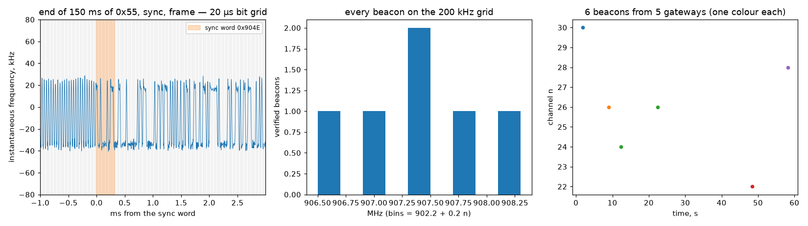

# Amazon Sidewalk beacons — the 140 ms preamble and the 10.08 s clock

Every Amazon Echo and Ring bridge with Sidewalk switched on is a gateway for
a neighbourhood radio network in the 900 MHz ISM band, and every gateway
announces itself with a **Beacon every 10.08 seconds** on a hopping channel.
An endpoint that has never heard the network scans 69 channels looking for
one, so the Beacon's preamble has to be long enough that the scan cannot
miss it: the specification says **140 ms**, which is why these bursts stood
out in a band of 5 ms meter chirps. The ERT entry logged them as a "156 ms
burst type we did not chase"; this is the chase.

The physical layer is IEEE 802.15.4g SUN FSK with the standard sync word and
header, data whitening and CRC; the frame inside is Sidewalk's own Beacon.
Nothing in a Beacon is encrypted (the spec says so: it carries the gateway's
cloud status and hopping seed), but nothing in it is anyone's business
either, so this entry measures the grid and masks the identities.

## The grid

| element | spec (Amazon Sidewalk Specification 1.0, §5.7, §5.2, App. B) | measured |
|---|---|---|
| Modulation | GFSK, BT 1, modulation index 1 | 2-FSK, deviation **±28.5 kHz** (spec 25 kHz) |
| Bit rate | 50 kbit/s | **49,999 bit/s**: bit period 20.000 µs, the same to 1 ns across bursts |
| Channels | 902.2 + 0.2 n MHz, n = 0..68 | every verified burst within 25 kHz of a grid line; n = 5, 16, 19, 22, 24, 26, 28, 30, 32, 38 seen |
| Beacon preamble | 140 ms of 0x55 | **149.7 ms** of alternating bits before the sync word (spread 0.1 ms across bursts) |
| Sync word | `0x904E` (802.15.4g uncoded SFD) | found in every burst |
| PHR | 802.15.4g: FCS type, whitening, 11-bit length | `0x1820`: 16-bit FCS, whitening on, **32 bytes** |
| Whitening | PN9, x⁹+x⁵+1, seed all ones | PN9, with the PSDU aligned **9 bits into the sequence**; found as the only phase of 511 that zeroes the CRC, the same on every frame |
| Integrity | CRC-16 CCITT (x¹⁶+x¹²+x⁵+1) | CRC over the transmitted bits = 0 after dewhitening, **10/10 frames** (two captures) |
| Beacon frame | frame control, header version, 5-byte gateway ID, 5-byte PAN ID, status, power, 4-byte hopping seed, 2-byte hop sequence, CS schedule, auth tag | 32 bytes: `20 00` (type Beacon, protocol 0100, header 0), IDs, `07 0a`, seed, sequence, `20 81 10 4c 90 4c` schedule block, 4-byte tag, FCS — exactly the spec's field order and sizes |
| Beacon period | 10,080 ms (160 slots × 63 ms) | **10.081 s** between two Beacons of the same gateway |

Two things the frames show that the spec does not say out loud: the
**hopping seed is the last four bytes of the gateway's own ID** (true for
all gateways we decoded), and the two-byte hop sequence number differs
between gateways and advances between Beacons.

## What we measured

Capture A: 60 s at 2 MS/s centred 907.4 MHz (channels 21–31 in view),
RSPdx, discone, fixed gain, 0 overflows. Capture B (survey): 12 s at 8 MS/s
centred 907.0 MHz, eight bursts saved and analysed offline.

```
bursts >= 100 ms: 6 in 60 s
FSK bursts analysed: 6; with SFD 0x904E: 6; CRC-verified frames: 6
bit period: 20.000 us = 49999.1 bit/s (spread 0.001 us); deviation ±28.5 kHz
preamble before the SFD: median 149.7 ms, 10-90 % 149.7-149.8 ms (spec beacon preamble 140 ms)
PHR: lengths {32: 6}, FCS16 flag {1: 6}, whitening flag {1: 6}, PN9 phase that zeroes the CRC {9: 6}
first three dewhitened octets: {'200005': 6}
channels used (n in 902.2 + 0.2 n MHz): 22, 24, 26 (x2), 28, 30
distinct gateway IDs (hashed): 5; seen more than once: 1
same-gateway gaps: [10.081] s -> per beacon 10.081 s (spec 10.080 s), residual +1 ms
beacons per second in this 60 s, 2 MHz window: 0.10
```
Capture B, four complete frames: preamble 149.8 ms, 50.00 kbit/s, ±28 kHz,
same SFD/PHR/whitening phase, CRC 0 on all four; residue before
dewhitening 0x4112 on all four (the first sign that the CRC family was
right before the whitening was known).



Left: the discriminator output around one Beacon's sync word, on its
20 µs bit grid (grey): the last bits of 150 ms of 0x55, the sync word
(shaded), then the frame. Middle: verified Beacons land on the
902.2 + 0.2 n MHz grid lines. Right: Beacons in time by channel, one
colour per gateway (hashed ID).

## How many gateways are around

A 2 MHz window sees 11 of 69 channels; 6 Beacons in 60 s there, and
15–16 per 12 s in an 8 MHz window, extrapolate to roughly **1–2 Beacons per
second across the band**, i.e. on the order of **10–20 gateways** within
range of a rooftop antenna in a suburban street. Several are ours; most
are the neighbours' Echos. The number is a lower bound (weak gateways are
missed) and a rough one (the two captures disagree by 2×).

## Honesty notes

- **It took three wrong guesses to get here.** The bursts were first read
  as LoRaWAN (156 ms is a plausible SF9 uplink; the dechirp test said no at
  every spreading factor), then as a long 802.15.4g data frame (the SFD
  turned up 150 ms *into* the burst — because the burst *is* 150 ms of
  preamble), then the CRC refused every textbook convention until the
  whitening was found by its phase. What settled it was not a decoder but
  the constant residue: four different frames leaving the same 16-bit
  remainder is a 1-in-10¹⁴ coincidence, so the CRC family was right and
  the scrambling was wrong — a linearity argument, then a 511-phase search.
- **The PN9 phase of 9 is what we measure, not what the spec says.** The
  spec gives "PN9 with starting condition 0xF" and the standard says the
  LFSR starts at all ones at the first PSDU bit. Our dewhitening works
  with the sequence starting at all ones *nine bits before* the PSDU — the
  same thing if the generator is clocked from the first bit of the PHR
  plus one, or a different output tap. We report the phase that makes
  10/10 CRCs zero and leave the bookkeeping to someone with the silicon.
- **149.7 ms of preamble against a specified 140 ms.** The spec sizes
  the Beacon preamble at (channels + 1) × (detect + change) = 70 × 2.0 ms
  = 140 ms and lets implementations extend it "for time drift
  compensation"; every gateway we heard adds the same ~10 ms. Measured
  from the first alternating bit to the sync word, bit-exact.
- **Deviation reads 28.5 kHz against a specified 25 kHz.** Our estimate is
  the 10th/90th-percentile spread of a discriminator after a 60 kHz
  filter, which overshoots on Gaussian-shaped transitions; the true value
  is likely the spec's. The bit rate, by contrast, is exact.
- **One gateway seen twice is one period measurement.** 10.081 s against
  10.080 is a 100 ppm agreement, which is the gateway's crystal and ours
  combined; one pair is not a statistic. A capture covering all 69 channels
  for a few minutes would turn this into a population.
- **Beacons are the easy frames.** Data frames between endpoints and
  gateways are short, encrypted, and far rarer in a street with few
  endpoints; we saw none we could verify. This entry is the gateway side.
- **Whose Echo is which is deliberately not in here.** Gateway IDs are
  hashed to four hex digits for the plots and never printed; the capture
  stays in the gitignored `captures/`.

## Reproduce it

```
python measure.py --iq sidewalk.cs16 --fs 2000000 --fc 907.4e6 [--png figures/sidewalk.png]
```
Tune anywhere in 902–928 MHz with a window of a few MHz, 2 MS/s is plenty
(the signal is 100 kHz wide), fixed gain, 60 s or more. Any Echo with
Sidewalk on is a transmitter; if you own one, unplugging it and watching a
hashed ID disappear is a satisfying control. For the decoding path, the
spec is public: docs.sidewalk.amazon, Protocol Specification 1.0.
