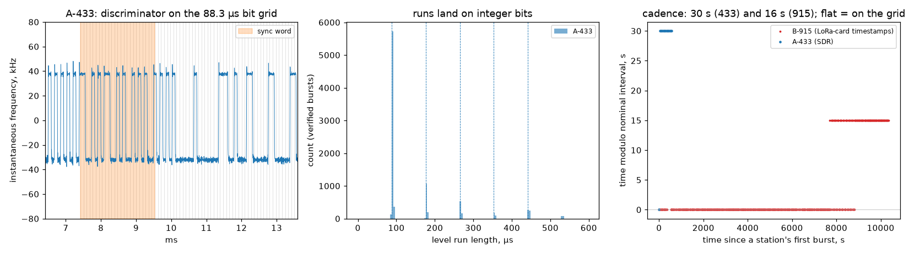

# Two 7-in-1 weather stations — the 30-second and the 16-second grids

A backyard weather station is a small FSK transmitter that tells an
indoor display the temperature, humidity, wind, rain and light every
few seconds, on a fixed channel in an ISM band. We measured two of them
from one house: **station A**, a store-brand 7-in-1 unit on
**433.9 MHz** (rtl_433 knows the family as *Emax W6*, and this unit
answers as "IMETEO-X6"), and **station B**, a *Fine Offset WH65B*
somewhere nearby on **915.0 MHz**. The two designs solve the same
problem with different numbers, and both keep time better than the
documentation says.

## The grid

| element | station A (433 MHz) | station B (915 MHz) |
|---|---|---|
| Channel | 433.90 MHz (dial 433.92 − 20.2 kHz, spread 1.3 kHz over 20 bursts) | 915.03 MHz |
| Modulation | 2-FSK, NRZ | 2-FSK, NRZ |
| Deviation | **±35.7 kHz** | not measured here (see honesty notes) |
| Bit period | **88.27 µs = 11,329 bit/s** (rtl_433 uses 90 µs: 2 % off) | **58 µs = 17,241 bit/s** (the LoRa card decodes it at exactly that rate) |
| Preamble / sync | `0xAA…` then **`CA CA 54`** | `0xAA…` then **`2D D4`** |
| Frame | **32 bytes**: model/channel, 12-bit ID, flags, temperature, humidity, wind, gust, direction, rain, UV, light, …, 8-bit **sum of the first 31 bytes** | **17 bytes**: family `0x24`, 8-bit ID, direction, temperature, humidity, wind, gust, rain, UV, light, **CRC-8 (0x31)** then an 8-bit sum |
| Burst | 118.6 ms (≈ 1,340 bits with preamble) | ~6 ms on the SDR; 40-byte blocks on the LoRa card |
| Cadence | **29.999 s, rms jitter < 1 ms** over 19 consecutive bursts | **16.000 s** over 572 frames, rms 249 ms as seen through a USB receiver |
| ID | 12 bits, **new random value at every power-up** (seen three times in one afternoon) | 8 bits, fixed |
| Start-up mode | one burst every **1.5 s** for the first minutes after power-up (indoor display's pairing window), then 30 s | — |

What the two grids have in common is the receiver they are built for:
a display that sleeps, wakes on a timer it trusts, hears one burst, and
sleeps again. That is why the cadence is the most exact number in each
system — the 30 s grid of station A holds to a millisecond — while the
bit clock can be 2 % off its documented value without anyone noticing:
a 118 ms burst needs the receiver's bit clock to stay within half a bit
over 1,340 bits, so the transmitter's RC oscillator is good enough.

## What we measured

Station A: RSPdx, 433.92 MHz, 250 kS/s, 600 s, discone, fixed gain.
Station B: the same SDR at 915.03 MHz, 70 s, and a RAK5146 LoRa
concentrator on an attic antenna running for 2.9 h (a retired Helium
hotspot; the receiver recipe is [helium-upcycle, chapter 8](https://github.com/Felbs/helium-upcycle/blob/master/docs/08-weather-station-receiver.md)).

```
synthetic self-test: 6/6 frames verified bit-exact (3 per station, random carrier offsets, 20 dB SNR)

== A-433  (600 s)
bursts >= 50 ms at 8x the floor: 21
verified frames: 20 / 21 FSK-shaped bursts   polarity: all 20 with a logical 1 on the UPPER tone
stations heard (ID masked): 1
bit period: 88.27 us median over verified bursts (nominal 90 us -> 11329 bit/s, -19255 ppm); spread 0.01 us
deviation: ±35.7 kHz median (10-90 % tone levels)  burst length: 118.6 ms
  station ..14 ch4: 20 verified bursts, carrier -20.2 kHz from dial (spread 1.3 kHz);
                    cadence 29.999 s (nominal 30 s, rms jitter 0 ms, 19 consecutive / 0 with gaps)
run-length peaks (us, all FSK bursts, no decoding): 88, 176, 264
referee (rtl_433 on the same file): 20 frames {'IMETEO-X6': 20}; IDs ['14']

== B-915  (SDR, 70 s, high gain)
bursts >= 4 ms at 8x the floor: 10;  verified frames: 0 / 8 FSK-shaped bursts

== B-915 via the LoRa card: 572 CRC+sum-verified frames in 2.88 h = 199/h of 225 possible (88 %)
cadence from receive timestamps: 16.000 s per frame (nominal 16 s), rms 249 ms (includes USB/host timing);
                                 consecutive 508, one missed 57, two missed 5
```

| constant | published | measured |
|---|---|---|
| A bit period | 90 µs (rtl_433 `emax.c`) | **88.27 µs**, the same to 0.01 µs on all 20 bursts; the run-length histogram of the raw discriminator peaks at 88, 176, 264 µs with nothing decoded |
| A deviation | not published | ±35.7 kHz |
| A cadence | "every 30 s" | 29.999 s, 19 consecutive intervals, no jitter we can resolve at 100 µs |
| A integrity | 8-bit sum over 31 bytes (`emax.c`) | 20 of 21 bursts pass; the 21st is a collision with another 433 MHz device |
| A ID | 12 bits | changed at each of three power-ups during the day: it is random, not a serial number |
| B bit rate | 17,241 bit/s (58 µs) (rtl_433 `fineoffset.c`) | the LoRa card's FSK modem set to 17,241 bit/s verifies 88 % of all frames for 2.9 h; at 11,260 or 11,494 bit/s it hears nothing |
| B cadence | 16 s | 16.000 s |
| B integrity | CRC-8 poly 0x31 + sum | both pass on every logged frame (the logger keeps only frames that pass both) |



Left: station A's discriminator output on its 88.3 µs bit grid (grey),
sync word shaded: every level change sits on a grid line. Middle: level
run lengths from all of station A's bursts pile up at 1, 2, 3 bits. Right:
burst times modulo the nominal interval — station A (SDR) is a flat line
at 30 s; station B (LoRa-card timestamps) is a flat line at 16 s with
the receiver's USB jitter on top.

## Honesty notes

- **Station B is measured through a different instrument than station
  A, and the table says so.** On the SDR with the rooftop discone the
  915 MHz station is 7–8 dB above the floor: its bursts appear exactly
  on the LoRa card's 16 s comb, but no frame decodes. The LoRa
  concentrator on the attic antenna verifies 88 % of its frames. So B's
  bit rate is known from a receiver that only works when set to it, its
  cadence from that receiver's timestamps, and its deviation not at all
  (the card reports bits, not frequency). A capture with the attic
  antenna on the SDR would close that gap.
- **We first ran station A through the wrong decoder.** Its sync word
  `CA CA 54` is shared with the *Vevor 7-in-1* format (21 bytes, a
  checksum at byte 19, a repeated TX counter), which is "based on the
  Emax protocol". The frames extracted cleanly but failed that checksum;
  rtl_433 with every decoder enabled named the unit IMETEO-X6, i.e. the
  33-byte Emax layout with the sum at byte 31. Same preamble, same sync,
  same bit rate, different frame: the sync word identifies a radio
  family, not a message format. A 5-minute false lead that the referee
  settled.
- **The ID is random, and that matters for anyone logging it.** The
  station took a different 12-bit ID after each battery change (three
  in one afternoon). A logger keyed on the ID stops working at the next
  battery change; key on channel and format instead.
- **Fields we could not confirm.** Bytes 13–15 of station A's frame
  (UV and light in the Emax layout) stayed at `C1 01 01` indoors and
  outdoors in daylight; this unit may not carry those sensors despite
  the "7-in-1" label (the IMETEO-X6 variant in `emax.c` is listed
  "without UV/LUX/Gust"). The rain counter did step with water poured
  into the funnel and held still afterwards.
- **Station B's "16.000 s" is a 1-second-quantized median, and the comb
  drifts.** The LoRa-card timestamps are whole seconds. Against a 16 s
  grid the station sits at phase 0 for 2.1 h, then at −1 s for the rest
  (the right panel's step): one second lost every ~7,700 s, i.e. a
  period of **15.998 s, about 130 ppm fast** — an ordinary crystal. The
  alternating 15 s / 17 s gaps around the step are the same quantization.
  Station A's 29.999 s comes from the SDR at 100 µs resolution and shows
  no step in 10 minutes; its drift, if any, is below 30 ppm.
- **The 1.5 s start-up burst rate is real but not in this capture.**
  Seen live for several minutes after each power-up (the outdoor
  unit's LED blinks with each burst), then the unit drops to 30 s. We
  did not record it.
- **The 433 MHz band had company.** 21 bursts over 50 ms in 10 minutes
  included one collision (the unverified burst) with another device;
  a garage-door remote, a LaCrosse sensor and two Security+ openers were
  decoded in the same band in the same hour. The busier band made the
  threshold matter: at 6× the floor the burst scan counted 3,041
  "bursts", mostly noise; at 8× and ≥ 50 ms it counted the 21 real ones.

## Reproduce it

```
python measure.py --iq433 wx433.cs16 [--iq915 wx915.cs16] --fs 250000 \
    [--ref433 rtl433_433.jsonl] [--lora-log wxlocal.jsonl] [--png figures/wx.png]
```
Station A: tune 433.92 MHz, 250 kS/s, fixed gain, 10 minutes catches 20
bursts. Referee: `rtl_433 -r cap.cs16 -s 250k -f 433.92M -R 215 -F
json:rtl433_433.jsonl`. Station B: a receiver with a good antenna; the
LoRa-card recipe is [helium-upcycle, chapter 8](https://github.com/Felbs/helium-upcycle/blob/master/docs/08-weather-station-receiver.md).

**Privacy:** IDs are masked to two digits and no readings are printed.
One of these stations is a neighbour's; nothing here says where either
one is.
