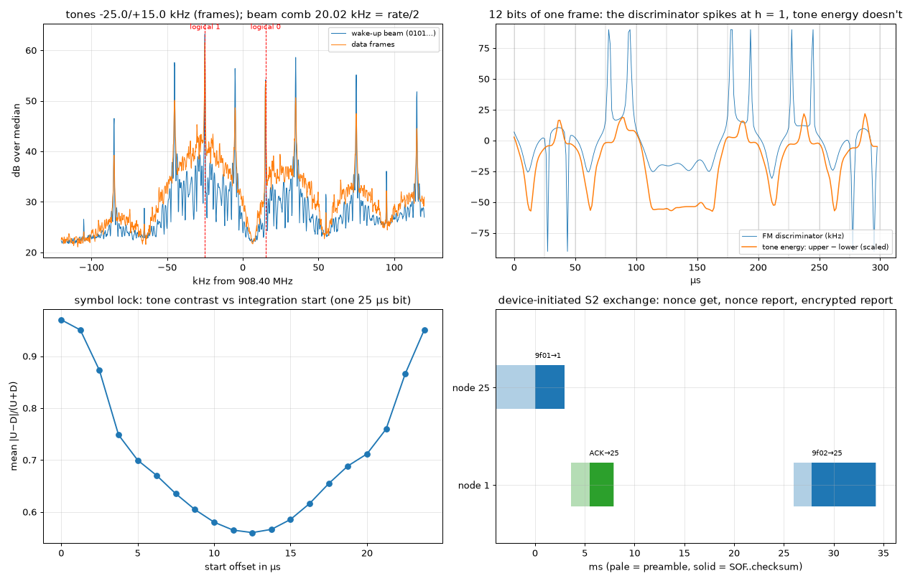

# Z-Wave R2 (908.4 MHz) — two tones exactly one bit-rate apart

## The grid

| parameter | value | why |
|---|---|---|
| Channel | 908.40 MHz (US; the 9.6 kbit/s R1 mode sits at 908.42, the 100 kbit/s R3 mode at 916.00) | one channel, no hopping: a sleeping battery device must know where to listen |
| Modulation | 2-FSK, NRZ, **40 kbit/s** | |
| Deviation | **±20 kHz** | h = 2·dev/rate = **1** — the two tones are exactly one bit-rate apart |
| Bit polarity | a logical **1 is the lower tone** | the opposite of what both LoRa-chip FSK modems we tried do natively |
| Frame | preamble 0x55… (≥ 10 bytes), SOF **0xF0**, Home ID (4), source node, frame control (2), length, destination node, payload, XOR checksum (init 0xFF) | length counts everything from Home ID to checksum |
| Wake-up beam | ~5 ms fragments `0x55, node, home-ID hash`, repeated for **1.11 s** | a battery device ("FLiRS") wakes for a moment every second, so the beam must outlast a second |

Why h = 1 matters: across one bit, the tone 20 kHz above centre turns
exactly one cycle more than the tone 20 kHz below it. Correlate a bit's
samples against each tone and one sum is large, the other is nearly zero
— the two tones are **orthogonal over a bit**. That suggests the receiver:
don't measure frequency, measure *which tone has the energy*.

```
for each bit:   U = | Σ x·e^(−j2π(c+20k)t) |²     D = | Σ x·e^(−j2π(c−20k)t) |²
                bit = 1 if D > U else 0           (1 = lower tone)
symbol lock:    slide the 25 µs window; keep the start that maximises mean |U−D|/(U+D)
```

## What we measured (RSPdx, 8 MS/s centred 912.2 MHz, channel cut to 800 kS/s)

Two 45 s captures of a commercial alarm hub (controller) and a battery Z-Wave
Plus thermostat: **A** while the setpoint was changed from the hub's phone
app, **B** with the thermostat carried into the radio room and its own
buttons pressed.

```
                                   capture A          capture B
tones (data frames)                −25.00/+15.04 kHz  −25.00/+14.84 kHz
centre (both radios' crystals)     −4.98 kHz          −5.08 kHz         (≈ −5.5 ppm)
deviation                          ±20.02 kHz         ±19.92 kHz
h = 2·dev/rate                     1.001              0.996
beam comb spacing (0101 → rate/2)  20.020 kHz         —
checksum-verified frames           58                 33
polarity of every one              1 = lower tone     1 = lower tone
beam fragments                     2234 (node 25)     —
```



**The bit clock, three ways.** The wake-up beam is mostly 0101…, which puts
spectral lines every rate/2: **20.02 kHz → 40.04 kbit/s**. The discriminator's
transition spikes on capture B's frames make a line at **39.996 kHz** (+21.7 dB)
— on capture A the same search ran to the edge of its window (200 kHz) and is
not counted. And the checksum is a ruler: a 408-bit frame decodes on a
*fixed* 40 000 bit/s clock with no tracking, so the true rate is within
**±49 bit/s (±0.12 %)** of 40 000.

**Who answers how fast** (capture B, the thermostat-initiated exchanges):

| node | silence after the last bit | then preamble before its SOF |
|---|---|---|
| hub (mains-powered) | **0.60 ms** (4 of 4: 0.59–0.65) | 1.87 ms |
| thermostat (battery) | **3.3 ms** (3 of 3: 3.24–3.42) | 3.93 ms |

That 0.6 ms is the number a home-built controller has to live with.

**What a button press looks like** (bottom-right panel): the thermostat asks
for an S2 nonce (`9F 01`), the hub ACKs and sends one (`9F 02`), the
thermostat ACKs, sends its encrypted report (`9F 03`), the hub ACKs. Every
command we saw was S2-encapsulated: the frame layer is in the clear (who,
to whom, sequence), the payload is not.

## How we found it

- **The live filter couldn't keep up.** A Python burst detector running at
  8 MS/s on a fanless Celeron kept 45 % of the samples. Recording straight
  to RAM kept 99.9 %. Measure afterwards; check samples against the wall
  clock before believing any capture.
- **The first antenna was too weak, and nothing said so.** On the roof
  discone the bursts were there (the 1.1 s beam is unmistakable) but at
  9 dB; nothing decoded. On another input, 13 dB, and the same code
  started finding SOFs. A third device — the thermostat — was never heard
  at all until it was carried into the room (it transmits about 6 dB
  below the hub).
- **The FM discriminator is fragile at h = 1.** The first decoder sliced
  the discriminator: plenty of SOFs, almost no valid checksums. Every
  tone change at h = 1 is a full half-turn of phase inside a narrow
  channel filter, and the discriminator spikes (top-right panel). We
  compared four discriminator set-ups against tone energy on the same
  bursts:

  | detector | capture A | capture B |
  |---|---|---|
  | discriminator, 45 kHz filter, no clip | 0 | 0 |
  | discriminator, 45 kHz filter, clip ±40 kHz | 0 | 2 |
  | discriminator, 60 kHz filter, clip ±40 kHz | **59** | 26 |
  | discriminator, 30 kHz filter, clip ±30 kHz | 0 | 0 |
  | tone energy (no filter or clip to tune) | 58 | **33** |

  Get the filter right and the discriminator matches tone energy on the
  strong hub frames. It loses a fifth of the weak thermostat frames, and it
  only works for one of the four set-ups. Our first write-up said "the
  discriminator decodes nothing" — that was our filter, not the method.
- **Polarity is not a convention you can assume.** Every frame decoded
  with 1 = lower tone. Then we made two LoRa chips (SX1301, SX1262) talk
  Z-Wave to each other: they agreed with each other, and both were
  *inverted* relative to the real network. The final proof was one receive
  window on the SX1262 that caught real controller frames and our
  bit-inverted transmissions together: both decoded with the same
  polarity, all checksums good. The transmit code is in
  [zwave-sdr](https://github.com/Felbs/zwave-sdr).
- **The beam's spectrum lies about the tones.** A 0101 pattern is a comb
  of lines 20 kHz apart; the two strongest were −25 and +35 kHz, not the
  two tones. Measure the tones on data frames (random bits put the energy
  on the tones themselves); use the beam for the comb spacing.

## Addendum: a device joining a network, measured live

With the thermostat released from its original hub and its owner pressing
*include* on it, the SDR recorded what a device does to find a hub. Then the
same thermostat was added to a home-built hub (an ex-Helium hotspot's SX1302
concentrator running [zwave-sdr](https://github.com/Felbs/zwave-sdr)), with
every frame on the air recorded.

**What a device in include mode sends** (two attempts, 50 s capture):

| | |
|---|---|
| first | one **49.7 ms** burst at **908.42 MHz** — the 9.6 kbit/s R1 channel, for old hubs |
| then | a **14.3 ms** broadcast on 908.40 MHz at 40 kbit/s, repeated **4×, 4.0 s apart**, then "failed" |
| frame | **50 bytes**: a 12-byte hub-search envelope (frame type 5) around the node-information frame (`01 01`, three capability bytes, generic 08 = thermostat, specific 06, twenty command classes) |
| preamble | **~170 bits** (4.3 ms) — longer than the alarm hub's ~90 or a mains device's |
| Home ID | random, different on every attempt; node ID 0 |

**Why a chip can hear the hub and not the device.** The SX1302's FSK modem,
once it detects a preamble, waits a fixed number of bit-times for the sync
pattern — **128 by default**. The alarm hub's frames and our own test
frames arrive inside that window; the thermostat's 170-bit preamble runs
past it, the modem gives up, and the start marker arrives to a modem that
has stopped listening. From a metre away, every attempt failed; with the
timeout raised to 1023, the first attempt joined. A radio that hears some
senders and not others is often a timing window, not a sensitivity problem.

**The join, as recorded** (times from the device's last announcement):

| step | frame | gap |
|---|---|---|
| hub → device | assign node ID 2 under the hub's Home ID (`01 03`, 7 bytes) | — |
| device → hub | ACK | 31 ms after the hub's transmission started |
| hub → device 2 | request node information (`01 02`) | |
| device 2 → hub | node-information frame, now under the hub's Home ID | 31 ms |

**Waking a sleeping device.** The thermostat is a "frequently listening"
battery device: it wakes for a moment every second. To reach it the hub
sends the 1.11 s beam measured earlier (`0x55, node, hash`), and the hash
byte depends on the network's Home ID in a way one or two samples do not
pin down (94 CRC-8 variants fit the first). Trying each value with a beam
and a request found it on the third try; the device then answered every
request within ~31 ms. Two beams back-to-back lose the reply — leave the
device a few seconds.

**Reports without asking.** With the hub written into the device's
"lifeline" association group, a button press at the thermostat produced a
setpoint report on its own (`43 03 01 2A 02 B2` = 69.0 °F), and a mode
change produced `40 03 01`; both acknowledged by the hub within the window
measured above. Over the air the node-information frame carries **no
basic-device-class byte** — capabilities, generic, specific, command
classes — unlike the serial-API form that controller software sees.

## Reproduce it

```
python measure.py --iq capA.npy capB.npy --fs 800e3            # channel already at 908.40 MHz
python measure.py --iq cap.cs16 --fs 2e6 --offset-khz -500     # raw int16 I/Q, channel 500 kHz below centre
```

Any SDR that covers 908 MHz and writes I/Q, near any Z-Wave network you
own. Change something from the controller's app to make traffic on demand;
press buttons on a battery device to hear it talk. Home IDs are masked in
the output (`********`): they identify a network, and a capture should not
be shared without masking them.
